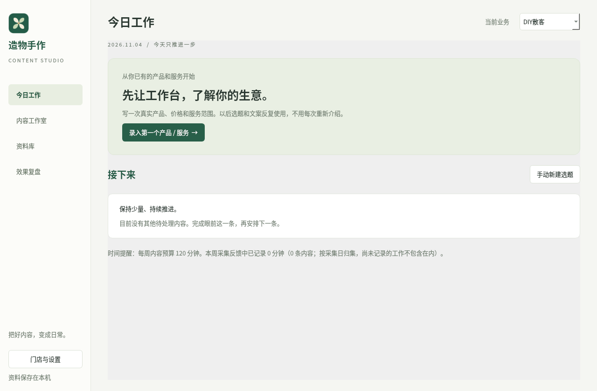

# 造物手作 · AI 获客与内容运营工作台

面向一个人经营的汕头手作门店。四个入口：**今日工作、内容工作室、资料库、效果复盘**。围绕一条内容逐步完成选题、素材、草稿、发布记录和复盘。



## 安装使用（Windows x64）

到仓库的 [Releases](https://github.com/jackychan2021620-design/text/releases) 查找“造物手作内容工作台”试用版，下载 `ZaowuContentStudio-Setup-0.2.0.exe`。

双击安装，保留“创建桌面快捷方式”，完成后从桌面或开始菜单打开。**安装包内置运行环境，无需另装 Python 或输入启动命令。** 只有 Windows 构建与打包检查成功后工作流才会发布安装包；没有附件时不能视为已经构建完成。

## 第一次使用

1. 在“门店与设置”填写门店事实、当前目标与时间预算。
2. 在“今日工作”录入一个真实产品 / 服务，补充价格、服务内容与预约方式。
3. 在“资料库 → 参考案例”粘贴实际看到的内容或视频描述，保留来源和观察日期。保存链接不会自动读取平台内容。
4. 从案例建立选题，或让 AI 结合资料提出最多四条未来两周的待验证选题。加入计划前会展示确认列表，任何一条不合法都会整批回滚。
5. 打开内容：确定顾客与假设 → 选择已有素材 → 编辑 / 生成草稿 → 检查后自行发布 → 记录真实反馈和下一步。

所有步骤可以手动完成。未配置 AI 不妨碍本地资料管理与创作。

## 七项能力如何落地

| 能力 | 当前入口和行为 |
|---|---|
| 经营条件记忆 | 门店背景、时间预算、产品服务；按业务调用，避免反复介绍 |
| 案例拆解 | 原文摘录、可观察反馈、AI 分析表达机制 / 本地相关性 / 制作负担 |
| 选题计划 | 人工建立或 AI 提出最多四条，人工确认后加入“选题”阶段 |
| 素材复用 | 本地图片视频归档、去重、关联内容、文字描述与补拍建议 |
| 内容草稿 | 标题、封面、正文、脚本、咨询引导；AI 草稿确认后填入编辑区，不自动保存或发布 |
| 咨询辅助 | 根据真实服务资料和当次问题生成回复草稿；用户自行检查和发送 |
| 效果与学习 | 累计反馈快照、本地咨询与传播分开、AI 复盘、逐条授权的长期记忆 |

**当前边界：** 已接入的是文本 AI 协议；真实 DeepSeek 需要你的有效 Key 和模型配置。平台自动抓取、图片像素识别、视频识别 / 自动剪辑、自动发布与投放均未接入。图片可本地预览，视频可交由系统播放器打开；AI 只使用人工填写的素材描述，不能声称看过图像。公开互动不能证明曝光或成交。

## AI 配置

在“门店与设置 → AI 连接”输入官方地址（默认 `https://api.deepseek.com`，可用 `/v1`）、自己的 Key，测试连接获取实际模型，选择并保存。模型名不预置。

Windows 优先把 Key 存到系统凭据库，独立条目 `ZaowuContentStudio.DeepSeek`；不会写进数据库、源代码或备份。凭据库不可用时可只保留当次运行内存，开发环境也可使用 `ZAOWU_STUDIO_API_KEY`。在系统凭据管理器可删除持久化条目。

每次发送都展示完整请求文本，包括当前任务资料和本次对话历史。确认后才联网。模型没有 SQL、自动发布、群发或费用操作能力；AI 结果保存到独立记录，应用到内容或经验库需另行人工操作。未完成回复保留但不自动应用、不进入完整对话历史。

官方文档：<https://api-docs.deepseek.com/>。当前云端文档访问及真实账户请求尚未验证；模拟协议测试不能替代真实联调。

## 反馈口径

- 指标未知时留空，明确零值才填 `0`。
- 每次记录的是截至采集日的**累计快照**；汇总每条内容按采集日期取最新一份，不将几天累计值重复相加。
- 曝光、阅读 / 播放、本地咨询、相关咨询、订单分别记录。没有地域数据时，不根据播放推测汕头覆盖。
- 毛利、投放、耗时由实际记录填写；贡献毛利不是净利润。跨内容归因请避免同笔订单重复计数。
- 首页时间提醒按反馈采集日归集已记录的累计耗时，可能不等于实际当周工时；未记录工作不包含在内。
- “观察事实”“待验证解释”“本店已验证”分级保存；事实 / 已验证记录要求填写依据，软件不会凭小样本自动升级为有效方法。

## 数据、备份与升级

Windows 数据目录：`%LOCALAPPDATA%\ZaowuContentStudio\`；数据库 `studio.sqlite3`，素材 `assets/`。与旧版 `ZaowuGrowthManager` 完全独立。Linux 为 `~/.local/share/ZaowuContentStudio/`。隔离测试可以设置 `ZAOWU_STUDIO_DATA_DIR`。

启动及每小时检查每日 SQLite 备份，保留最近 30 份。设置页“备份整个工作台资料”导出包含数据库、素材及 SHA256 校验清单的 ZIP，不含系统凭据。完整 ZIP 恢复会校验路径、大小、清单、数据库及文件哈希，并将素材路径转换到新电脑。SQLite 单文件恢复不包含素材。恢复前自动保留当前数据库，现有素材不删除。

备份目前未加密，请妥善保存。升级安装保留用户数据。卸载时默认保留，只有明确确认才删除该工作台的数据和素材，不会删除旧经营系统的数据。

## 开发和构建

Python 3.12。在本目录执行：

```sh
python -m venv .venv
# Windows: .venv\Scripts\python；Linux: .venv/bin/python
.venv/bin/python -m pip install -r requirements-dev.txt
.venv/bin/python -m pytest -q
.venv/bin/python launch.py
```

Windows 开发环境：`powershell -ExecutionPolicy Bypass -File scripts\setup-windows.ps1`。

Windows 打包：安装 Inno Setup 6，然后运行 `scripts\build-windows.ps1`。脚本先测试、生成原创品牌图标、PyInstaller 打包、运行打包程序独立启动检查，再编译中文安装包。产物位于 `dist\installer\`。GitHub 工作流 `studio-installer.yml` 在 Windows 执行相同步骤，成功后发布与提交绑定的 GitHub 试用版附件。

安装包运行检查不等于真人完成全部 Windows 操作和真实 AI 联调，发布前请执行 [验收说明](docs/ACCEPTANCE.md)。
